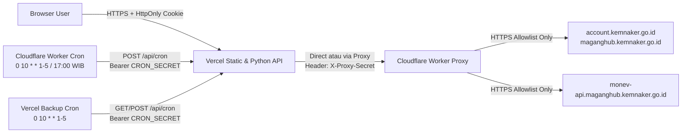

# Monev Presensi — Web Dashboard & Auto-Cron MagangHub Kemnaker

Aplikasi web ringan dan terproteksi untuk memantau serta mengirim presensi dan laporan aktivitas harian (*daily log*) MagangHub Kemnaker (SIAPkerja). Dibangun menggunakan Python 3.10+ *standard library* ditambah `cryptography` (`Fernet`) dari `requirements.txt`, di-deploy pada Vercel Serverless Functions, dan dilengkapi opsi **Cloudflare Worker** sebagai *reverse proxy* yang terkunci serta penjadwal cron otomatis pukul **17:00 WIB (Senin–Jumat)**.

> **Penting:** Gunakan aplikasi ini hanya untuk akun dan aktivitas yang memang menjadi hak Anda. Pastikan seluruh data presensi, lokasi, dan *daily log* sesuai kondisi sebenarnya serta mematuhi kebijakan MagangHub/Kemnaker. Jangan pernah menyimpan kredensial di repository publik.

[](https://www.python.org/)
[](https://vercel.com/)
[](https://workers.cloudflare.com/)
[](LICENSE)

---

## Gambaran Umum

- **Web Dashboard Sederhana (`public/`):** Antarmuka satu halaman untuk login SSO Kemnaker, melihat status presensi hari ini & riwayat 7 hari terakhir, mengacak koordinat kantor dalam radius 10 meter dari titik pusat YIA (`-7.9021141, 110.065129`), memilih template *logbook* yang belum pernah dipakai, serta mengirim presensi manual.
- **Stateless & Tanpa Database:** Seluruh sesi disimpan dalam cookie `HttpOnly; SameSite=Strict` yang dienkripsi dan ditandatangani menggunakan `cryptography.fernet.Fernet` (`AES-128-CBC` + `HMAC-SHA256`, kunci diturunkan melalui `SHA-256` dari `SESSION_SECRET`) dengan `Max-Age=19800` (5,5 jam).
- **Deteksi Template Tanpa File State:** Riwayat *daily log* langsung dibandingkan dengan API Kemnaker (`/daily-logs?limit=100&page=1`), sehingga tidak memerlukan file state lokal dan bebas dari masalah *ephemeral filesystem* serverless.
- **Auto-Submit Pukul 17:00 WIB (Senin–Jumat):** Endpoint `/api/cron` memeriksa apakah presensi hari ini sudah terkirim; jika belum, sistem otomatis memilih template yang belum terpakai, membangkitkan koordinat kantor dalam radius 10 m, dan mengirim presensi.
- **Hardened Cloudflare Worker (`cloudflare_worker.js`):** Proxy terkunci dengan `X-Proxy-Secret` (*constant-time comparison*, *fail-closed* `503`), *allowlist* ketat khusus domain HTTPS Kemnaker (`maganghub.kemnaker.go.id`, `account.kemnaker.go.id`, `monev-api.maganghub.kemnaker.go.id`), dan pemicu cron `POST /api/cron` dengan header `Authorization: Bearer <CRON_SECRET>`.

---

## Arsitektur



### Struktur Proyek

```text
monev-presensi/
├── api/
│   ├── auth.py                 # POST /api/auth login SSO, DELETE /api/auth logout
│   ├── status.py               # GET /api/status cek sesi, status presensi hari ini, profil, riwayat 7 hari, koordinat
│   ├── template.py             # GET acak template yang belum pernah dipakai
│   ├── submit.py               # POST kirim presensi & daily log manual
│   └── cron.py                 # GET/POST cron otomatis 17:00 WIB (Senin-Jumat)
├── lib/
│   ├── config.py               # Pembacaan & validasi konfigurasi environment
│   ├── geo.py                  # Generator & validator koordinat Haversine <= 10m (YIA)
│   ├── http_utils.py           # Header keamanan, CSRF check, JSON body reader, redaksi error
│   ├── kemnaker.py             # Klien SSO Kemnaker, pemilih template, submit presensi
│   └── session.py              # Enkripsi cookie sesi dengan cryptography.fernet.Fernet (Max-Age=19800)
├── public/
│   ├── index.html              # Antarmuka web utama (Strict CSP)
│   ├── styles.css              # Styling responsif
│   └── app.js                  # Logika frontend tanpa penyimpanan kredensial di storage
├── tests/                      # Unit test Python (unittest) & Cloudflare Worker (node:test)
├── cloudflare_worker.js        # Hardened Cloudflare Worker (Reverse Proxy + Cron Trigger)
├── dev_server.py               # Server pengembangan lokal (static + /api/*)
├── requirements.txt            # Dependensi Python (cryptography)
├── templates.json              # Koleksi 50 template aktivitas rekayasa aplikasi web ARFF YIA
├── vercel.json                 # Konfigurasi Vercel (region sin1, headers CSP, cron)
├── wrangler.toml               # Konfigurasi Cloudflare Worker & jadwal cron
└── .env.example                # Contoh variabel environment
```

---

## Model Keamanan

1. **Sesi Terenkripsi (`lib/session.py`):** Token akses Kemnaker (`naco_access_token`) tidak pernah terekspos ke JavaScript, `localStorage`, atau `sessionStorage`. Token dienkripsi menggunakan `cryptography.fernet.Fernet` (`AES-128-CBC` + `HMAC-SHA256`, kunci diturunkan melalui `SHA-256` dari `SESSION_SECRET`) di dalam cookie `monev_session` (`HttpOnly`, `SameSite=Strict`, `Secure` di produksi, `Max-Age=19800` / 5,5 jam). Pengecekan status sesi dan dashboard dilakukan melalui `GET /api/status`, sedangkan `api/auth.py` menangani `POST /api/auth` (login) dan `DELETE /api/auth` (logout).
2. **Proteksi CSRF (`lib/http_utils.py`):** Seluruh request `POST`/`DELETE` ke endpoint berautentikasi cookie wajib menyertakan header `Sec-Fetch-Site: same-origin` atau `Origin` yang cocok dengan `Host`.
3. **Strict Content-Security-Policy (CSP):** Seluruh halaman dan respons API menerapkan CSP `default-src 'self'; style-src 'self'; script-src 'self'; connect-src 'self'; frame-ancestors 'none'; base-uri 'none'; form-action 'self'` serta `X-Frame-Options: DENY` dan `X-Content-Type-Options: nosniff`.
4. **Geofence Ketat 10 Meter (`lib/geo.py`):** Koordinat dibangkitkan secara seragam di dalam lingkaran radius `OFFICE_RADIUS_METERS` (default `10.0` m, dibatasi `0.5 <= r <= 50.0`) dari titik pusat YIA (`-7.9021141, 110.065129`) dan divalidasi ulang dengan rumus Haversine pada koordinat 7 desimal sebelum dikirim ke Kemnaker.
5. **Autentikasi Cron (`api/cron.py`):** Hanya menerima header `Authorization: Bearer <CRON_SECRET>` dengan perbandingan waktu konstan (*constant-time*). Secret pada query string (`?secret=...`) ditolak sepenuhnya.
6. **Hardened Reverse Proxy (`cloudflare_worker.js`):**
   - *Fail-closed* (`503`) apabila `PROXY_SECRET` belum dikonfigurasi di Worker.
   - Menolak request tanpa `X-Proxy-Secret` yang valid (`403`).
   - Hanya mengizinkan protokol `https:` ke 3 hostname resmi Kemnaker (baik URL target awal maupun header redirect `Location`).
   - Menghapus header `X-Proxy-Secret` sebelum diteruskan ke upstream dan tidak mengeluarkan wildcard CORS (`Access-Control-Allow-Origin: *`).

---

## Konfigurasi Environment

Salin `.env.example` menjadi `.env` untuk penggunaan lokal, atau tambahkan variabel berikut pada **Vercel Environment Variables**:

| Variabel | Wajib | Keterangan |
|:---|:---:|:---|
| `SESSION_SECRET` | **Ya** | Kunci enkripsi cookie sesi (minimal 32 karakter acak). Generate dengan: `python -c "import secrets; print(secrets.token_urlsafe(48))"` |
| `CRON_SECRET` | **Ya** (untuk Cron) | Secret Bearer token untuk `/api/cron` (minimal 16 karakter). Harus sama di Vercel dan Cloudflare Worker. |
| `KEMNAKER_USERNAME` | **Ya** (untuk Cron) | Email atau NIK akun SIAPkerja/MagangHub yang digunakan oleh cron otomatis. |
| `KEMNAKER_PASSWORD` | **Ya** (untuk Cron) | Password akun SIAPkerja/MagangHub yang digunakan oleh cron otomatis. |
| `ALLOWED_USERNAME` | Opsional | Kunci *single-user* opsional; hanya diberlakukan apabila `ALLOWED_USERNAME` diset secara eksplisit (tidak otomatis mengambil nilai default dari `KEMNAKER_USERNAME`). |
| `CLOUDFLARE_WORKER_URL` | Opsional | URL Cloudflare Worker jika trafik ke Kemnaker diteruskan melalui proxy (misal `https://monev-proxy.user.workers.dev`). |
| `PROXY_SECRET` | **Wajib jika Proxy aktif** | Secret bersama antara Vercel (`X-Proxy-Secret`) dan Cloudflare Worker. |
| `OFFICE_LAT` | Opsional | Latitude pusat kantor (default `-7.9021141`). |
| `OFFICE_LONG` | Opsional | Longitude pusat kantor (default `110.065129`). |
| `OFFICE_RADIUS_METERS` | Opsional | Radius maksimum koordinat dari titik pusat dalam meter (default `10.0` meter, di-*clamp* pada rentang `0.5 <= r <= 50.0`). |

### Variabel Environment Cloudflare Worker

Konfigurasikan pada dashboard Cloudflare Worker (**Settings → Variables and Secrets**) atau melalui `wrangler secret put`:

| Variabel Worker | Wajib | Keterangan |
|:---|:---:|:---|
| `PROXY_SECRET` | **Ya** | Harus sama persis dengan `PROXY_SECRET` di Vercel. |
| `CRON_SECRET` | **Ya** | Harus sama persis dengan `CRON_SECRET` di Vercel. |
| `VERCEL_DOMAIN` | **Ya** | Domain deployment Vercel Anda tanpa slash penutup (misal `https://monev-presensi.vercel.app`). |

---

## Pengembangan Lokal

### Prasyarat

- Python 3.10 atau lebih baru (menggunakan *standard library* Python ditambah paket `cryptography` dari `requirements.txt`)
- Node.js 18+ (opsional, untuk menjalankan unit test Cloudflare Worker)

### Menjalankan Server Lokal

```bash
pip install -r requirements.txt
cp .env.example .env
# Edit .env dan isi minimal SESSION_SECRET (32+ karakter)

python dev_server.py
```

Buka `http://127.0.0.1:8000` di browser.

### Menjalankan Pengujian (Unit Tests)

```bash
# Test seluruh modul Python & endpoint API
python -m unittest discover -s tests -v

# Test Cloudflare Worker (Node.js built-in test runner)
node --test tests/test_worker.mjs
```

---

## Deployment

### 1. Deployment ke Vercel

1. Import repository ini ke Vercel.
2. Tambahkan variabel environment (`SESSION_SECRET`, `CRON_SECRET`, `KEMNAKER_USERNAME`, `KEMNAKER_PASSWORD`, serta opsional `CLOUDFLARE_WORKER_URL` dan `PROXY_SECRET`) pada **Project Settings → Environment Variables**.
3. Deploy proyek. `vercel.json` secara otomatis mengatur:
   - Region fungsi di Singapura (`sin1`) dengan `maxDuration: 60` detik.
   - Header keamanan & CSP pada seluruh route `/(.*)`.
   - Backup Vercel Cron ke `/api/cron` pada jadwal `0 10 * * 1-5` (17:00 WIB, Senin–Jumat).

### 2. Deployment Cloudflare Worker (Proxy & Cron 17:00 WIB)

```bash
npx wrangler login
npx wrangler deploy
```

Tambahkan secret pada Worker:

```bash
npx wrangler secret put PROXY_SECRET
npx wrangler secret put CRON_SECRET
npx wrangler secret put VERCEL_DOMAIN
```

`wrangler.toml` mengatur trigger cron tunggal:

```toml
[triggers]
crons = ["0 10 * * 1-5"]
```

Setiap pukul **10:00 UTC (17:00 WIB)** pada hari **Senin sampai Jumat**, Cloudflare Worker akan memanggil `POST https://<VERCEL_DOMAIN>/api/cron` dengan header `Authorization: Bearer <CRON_SECRET>`. Apabila presensi hari itu sudah dikirim sebelumnya (baik manual lewat web maupun oleh cron), endpoint akan mengembalikan `{"status": "already_submitted"}` tanpa mengirim duplikat.

---

## Lisensi

Proyek ini didistribusikan di bawah lisensi [MIT](LICENSE).
